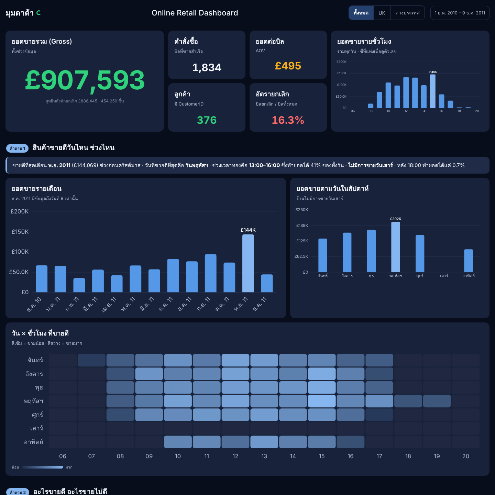

# Online Retail Dashboard · มุมดาต้า EP.1

วิเคราะห์ข้อมูลยอดขายของร้านค้าออนไลน์ในสหราชอาณาจักร ตั้งแต่คลีนข้อมูลใน Google Sheets จนถึงทำ Dashboard ที่ตอบคำถามธุรกิจ 4 ข้อ

🔗 **ดู Dashboard:** https://anawinputtakun.github.io/online-retail-dashboard/
📊 **Google Sheet (ดูได้อย่างเดียว):** [มุมดาต้า | Online Retail (EP.1)](https://docs.google.com/spreadsheets/d/186wX_yXPuGycvwryNvxjTdpSQ2ekKspduMfUmxdpUCI/edit?usp=sharing)



---

## สารบัญ

1. [โจทย์](#โจทย์)
2. [ข้อมูล](#ข้อมูล)
3. [การคลีนข้อมูล (แท็บ Clean Data)](#การคลีนข้อมูล-แท็บ-clean-data)
4. [การตรวจสอบความถูกต้อง](#การตรวจสอบความถูกต้อง)
5. [Dashboard และนิยามตัวชี้วัด](#dashboard-และนิยามตัวชี้วัด)
6. [คำตอบและ Insight](#คำตอบและ-insight)
7. [ข้อจำกัดของข้อมูล](#ข้อจำกัดของข้อมูล)
8. [โครงสร้างไฟล์](#โครงสร้างไฟล์)

---

## โจทย์

Dashboard ต้องตอบคำถาม 4 ข้อ

1. สินค้าขายดีวันไหน ช่วงเวลาไหน
2. สินค้าอะไรขายดี อะไรขายไม่ดี
3. สินค้าอะไรโดนยกเลิกบ่อย
4. กลุ่มลูกค้าของเราเป็นใครบ้าง

## ข้อมูล

| รายการ | รายละเอียด |
|---|---|
| แหล่งข้อมูล | Online Retail Dataset (Daqing Chen, UCI Machine Learning Repository, CC BY 4.0) |
| ขอบเขต | ข้อมูลบางส่วนของชุดเต็ม จำนวน **55,032 แถว** |
| ช่วงเวลา | 1 ธ.ค. 2010 – 9 ธ.ค. 2011 |
| หน่วยเงิน | ปอนด์สเตอร์ลิง (£) |

**คอลัมน์ในแท็บ RAW**

| คอลัมน์ | ความหมาย |
|---|---|
| `InvoiceNo` | เลขบิล ถ้าขึ้นต้นด้วย `C` คือบิลยกเลิก |
| `StockCode` | รหัสสินค้า |
| `Description` | ชื่อสินค้า |
| `Quantity` | จำนวนชิ้น (ติดลบในบิลยกเลิกและรายการปรับสต็อก) |
| `InvoiceDate` | วันและเวลาที่ออกบิล |
| `UnitPrice` | ราคาต่อชิ้น |
| `CustomerID` | รหัสลูกค้า (ว่างได้ ถ้าไม่ระบุตัวตน) |
| `Country` | ประเทศของลูกค้า |

---

## การคลีนข้อมูล (แท็บ Clean Data)

### หลักการ

- **ไม่แก้ข้อมูลในแท็บ RAW** ข้อมูลดิบยังอยู่ครบ ตรวจย้อนกลับได้เสมอ
- แท็บ **Clean Data** ใช้ **สูตรเดียวในเซลล์ A1** ที่ดึงจาก RAW มาคลีน ถ้า RAW เปลี่ยน Clean Data จะอัปเดตตามอัตโนมัติ
- ทุกเงื่อนไขอยู่ในสูตร คนอ่านคลิกเซลล์ A1 แล้วเห็นได้ทันทีว่าคลีนอะไรบ้าง

### สูตรเต็ม (เซลล์ A1 ของแท็บ Clean Data)

```
=ARRAYFORMULA(LET(
  inv,  TO_TEXT(RAW!A2:A),
  sc,   UPPER(TRIM(TO_TEXT(RAW!B2:B))),
  d,    UPPER(TRIM(REGEXREPLACE(TO_TEXT(RAW!C2:C), "\s+", " "))),
  q,    RAW!D2:D,
  dt,   RAW!E2:E,
  p,    RAW!F2:F,
  cid,  RAW!G2:G,
  ctry, RAW!H2:H,

  keep, (inv <> "")
      * (LEFT(inv, 1) <> "C")
      * (LEFT(inv, 1) <> "A")
      * (q > 0)
      * (p > 0)
      * (d <> "")
      * ISNA(MATCH(sc, {"POST","DOT","M","C2","BANK CHARGES","AMAZONFEE","S","B","D","CRUK","PADS"}, 0))
      * (LEFT(sc, 5) <> "GIFT_")
      * NOT((inv = "581483") * (q = 80995)),

  data, UNIQUE(FILTER(
          {VALUE(IF(keep, inv, 0)), sc, d, q, dt, TEXT(dt, "yyyy-mm"), p,
           ROUND(q * p, 2), IF(cid = "", "Unknown", cid), IF(ctry = "EIRE", "Ireland", ctry)},
          keep)),

  VSTACK(
    {"InvoiceNo","StockCode","Description","Quantity","InvoiceDate","YearMonth","UnitPrice","TotalPrice","CustomerID","Country"},
    SORT(data, 5, TRUE, 1, TRUE))
))
```

> การขึ้นบรรทัดใหม่ข้างบนมีไว้ให้อ่านง่าย ถ้าจะนำไปใช้ ให้คัดลอกสูตรบรรทัดเดียวข้างล่างไปวางในเซลล์ A1 ของชีตใหม่ (ถ้าวางสูตรที่ขึ้นบรรทัดใหม่ลงตัวเซลล์ Sheets จะแยกไปหลายแถว)

<details>
<summary>สูตรบรรทัดเดียว (สำหรับคัดลอก)</summary>

```
=ARRAYFORMULA(LET(inv,TO_TEXT(RAW!A2:A),sc,UPPER(TRIM(TO_TEXT(RAW!B2:B))),d,UPPER(TRIM(REGEXREPLACE(TO_TEXT(RAW!C2:C),"\s+"," "))),q,RAW!D2:D,dt,RAW!E2:E,p,RAW!F2:F,cid,RAW!G2:G,ctry,RAW!H2:H,keep,(inv<>"")*(LEFT(inv,1)<>"C")*(LEFT(inv,1)<>"A")*(q>0)*(p>0)*(d<>"")*ISNA(MATCH(sc,{"POST","DOT","M","C2","BANK CHARGES","AMAZONFEE","S","B","D","CRUK","PADS"},0))*(LEFT(sc,5)<>"GIFT_")*NOT((inv="581483")*(q=80995)),data,UNIQUE(FILTER({VALUE(IF(keep,inv,0)),sc,d,q,dt,TEXT(dt,"yyyy-mm"),p,ROUND(q*p,2),IF(cid="","Unknown",cid),IF(ctry="EIRE","Ireland",ctry)},keep)),VSTACK({"InvoiceNo","StockCode","Description","Quantity","InvoiceDate","YearMonth","UnitPrice","TotalPrice","CustomerID","Country"},SORT(data,5,TRUE,1,TRUE))))
```

</details>

### อธิบายทีละส่วน

สูตรแบ่งเป็น 4 ขั้น คือ **ตั้งชื่อตัวแปร → สร้างเงื่อนไขคัดแถว → คัดและแปลงข้อมูล → ใส่หัวตารางและเรียงลำดับ**

#### ขั้นที่ 1 · ตั้งชื่อตัวแปรด้วย `LET` และเตรียมค่าให้อยู่ในรูปเดียวกัน

`LET` ตั้งชื่อให้แต่ละคอลัมน์ เพื่อเรียกใช้ซ้ำได้โดยไม่ต้องเขียน `RAW!A2:A` หลายรอบ ส่วน `ARRAYFORMULA` ทำให้ทุกฟังก์ชันคำนวณทั้งคอลัมน์ในครั้งเดียว

| ตัวแปร | สูตร | เหตุผล |
|---|---|---|
| `inv` | `TO_TEXT(RAW!A2:A)` | เลขบิลมีทั้งตัวเลข (`536371`) และข้อความ (`C536379`) แปลงเป็นข้อความก่อน จึงใช้ `LEFT` เช็กตัวอักษรตัวแรกได้ |
| `sc` | `UPPER(TRIM(TO_TEXT(...)))` | รหัสสินค้าบางตัวมีช่องว่างหรือตัวพิมพ์เล็ก เช่น `gift_0001_20` ทำให้เป็นตัวพิมพ์ใหญ่ไม่มีช่องว่างก่อน แล้วค่อยเทียบ |
| `d` | `UPPER(TRIM(REGEXREPLACE(..., "\s+", " ")))` | ชื่อสินค้ามีช่องว่างซ้อน (291 แถว) และตัวพิมพ์ปนกัน (267 แถว) `REGEXREPLACE` ยุบช่องว่างหลายช่องเหลือช่องเดียว `TRIM` ตัดหัวท้าย `UPPER` ทำให้เป็นแบบเดียวกัน |
| `q`, `dt`, `p`, `cid`, `ctry` | อ้างคอลัมน์ตรงๆ | ใช้ค่าเดิม |

#### ขั้นที่ 2 · สร้างเงื่อนไขคัดแถว `keep`

`keep` เอาเงื่อนไขทุกข้อมา**คูณกัน** ใน Sheets ค่า TRUE = 1 และ FALSE = 0 ผลคูณจะเป็น 1 (เก็บแถว) ก็ต่อเมื่อ**ผ่านทุกเงื่อนไข** ถ้าตกข้อใดข้อหนึ่งจะได้ 0 (ตัดทิ้ง) ทำหน้าที่เหมือน `AND` แต่ใช้กับทั้งคอลัมน์ได้

| เงื่อนไข | ตัดอะไรออก | เหตุผล |
|---|---|---|
| `inv <> ""` | แถวว่างท้ายชีต | ช่วง `A2:A` ลากไปถึงแถวสุดท้ายของชีต จึงมีแถวว่างติดมา |
| `LEFT(inv,1) <> "C"` | บิลยกเลิก | บิลที่ขึ้นต้นด้วย C คือการยกเลิกหรือคืนสินค้า ไม่ใช่การขาย (แยกไปวิเคราะห์ในคำถาม 3) |
| `LEFT(inv,1) <> "A"` | บิล `A563185` | เป็นรายการปรับยอดหนี้สูญ (Adjust bad debt) ไม่ใช่การขายสินค้า |
| `q > 0` | Quantity ≤ 0 | ส่วนใหญ่เป็นการบันทึกของเสีย ของหาย หรือปรับสต็อก (เช่น damaged, found, check) |
| `p > 0` | UnitPrice = 0 | ของแถมหรือรายการปรับสต็อกที่ไม่มีรายได้ |
| `d <> ""` | ไม่มีชื่อสินค้า | ไม่รู้ว่าเป็นสินค้าอะไร (หลังผ่านเงื่อนไขอื่นแล้วไม่เหลือแถวแบบนี้ แต่ใส่ไว้กันพลาด) |
| `ISNA(MATCH(sc, {...}, 0))` | รหัสที่ไม่ใช่สินค้า | `MATCH` หารหัสในรายการ ถ้า**หาไม่เจอ**จะได้ `#N/A` และ `ISNA` จะเป็น TRUE หมายความว่าไม่ใช่รหัสต้องห้าม จึงเก็บไว้ ดูรายการรหัสในตารางถัดไป |
| `LEFT(sc,5) <> "GIFT_"` | บัตรของขวัญ | `gift_0001_20` เป็นต้น เป็นการขายบัตร ไม่ใช่สินค้า |
| `NOT((inv="581483")*(q=80995))` | ออเดอร์ผิดปกติ 1 แถว | สั่ง PAPER CRAFT, LITTLE BIRDIE 80,995 ชิ้น (£168,470) แล้วถูกยกเลิกด้วยบิล C581484 ภายใน 12 นาที ถ้าไม่ตัดจะทำให้ยอดขายเพิ่มขึ้นเกือบ 19% |

**รหัสที่ไม่ใช่สินค้า**

| รหัส | ความหมาย |
|---|---|
| `POST`, `DOT` | ค่าส่ง |
| `M` | Manual (ปรับยอดด้วยมือ) |
| `C2` | ค่าขนส่ง (Carriage) |
| `BANK CHARGES`, `AMAZONFEE` | ค่าธรรมเนียม |
| `S`, `B`, `D` | Samples / Adjust bad debt / Discount |
| `CRUK`, `PADS` | ไม่พบในข้อมูลชุดนี้ ใส่ไว้เผื่อใช้สูตรกับข้อมูลชุดเต็ม (CRUK = ค่าคอมมิชชัน Cancer Research UK, PADS = รายการราคาเกือบ £0) |

> รหัส `DCGS...` ยังเก็บไว้ เพราะเป็นสินค้าจริง (เช่น BOYS PARTY BAG, GIRLS PARTY BAG) แค่ใช้รูปแบบรหัสต่างจากตัวอื่น

#### ขั้นที่ 3 · คัดแถวและแปลงข้อมูลด้วย `FILTER` และ `UNIQUE`

`FILTER({...}, keep)` เลือกเฉพาะแถวที่ `keep = 1` และสร้างคอลัมน์ผลลัพธ์ 10 คอลัมน์

| คอลัมน์ผลลัพธ์ | สูตร | ทำอะไร |
|---|---|---|
| InvoiceNo | `VALUE(IF(keep, inv, 0))` | แปลงกลับเป็นตัวเลข (ใช้ `IF` กันไม่ให้ `VALUE` error กับบิลที่ขึ้นต้นด้วย C ซึ่งถูกตัดทิ้งอยู่แล้ว) |
| StockCode | `sc` | รหัสสินค้าที่ทำความสะอาดแล้ว |
| Description | `d` | ชื่อสินค้าที่ทำความสะอาดแล้ว |
| Quantity | `q` | เดิม |
| InvoiceDate | `dt` | เดิม |
| **YearMonth** | `TEXT(dt, "yyyy-mm")` | **คอลัมน์ใหม่** ใช้สรุปยอดรายเดือนใน Pivot ได้ทันที |
| UnitPrice | `p` | เดิม |
| **TotalPrice** | `ROUND(q * p, 2)` | **คอลัมน์ใหม่** ยอดขายของแต่ละแถว |
| CustomerID | `IF(cid = "", "Unknown", cid)` | เติมค่าว่างเป็น `Unknown` |
| Country | `IF(ctry = "EIRE", "Ireland", ctry)` | เปลี่ยนชื่อประเทศให้เป็นมาตรฐาน |

จากนั้น `UNIQUE(...)` ตัด**แถวที่ซ้ำกันทุกคอลัมน์**ออก

> **ทำไมไม่ลบแถวที่ไม่มี CustomerID**
> แถวเหล่านี้มี 12,747 แถว คิดเป็นยอดขาย £137,998 (15%) และเป็นการขายจริง ถ้าลบจะทำให้ยอดขายรวมต่ำกว่าความจริง จึงเก็บไว้และติดป้าย `Unknown` แทน ส่วนการวิเคราะห์รายลูกค้า (RFM) จะกรอง `Unknown` ออกตอนนั้น

#### ขั้นที่ 4 · ใส่หัวตารางและเรียงลำดับ

- `SORT(data, 5, TRUE, 1, TRUE)` เรียงตามคอลัมน์ที่ 5 (InvoiceDate) จากเก่าไปใหม่ ถ้าเวลาเท่ากันให้เรียงตาม InvoiceNo
- `VSTACK({หัวตาราง}, ...)` เอาแถวหัวตารางวางไว้บนสุด

> **หมายเหตุ:** ผลลัพธ์มีประมาณ 53,000 แถว แต่ชีตใหม่มี 50,500 แถว ต้องเพิ่มแถวให้พอก่อน (เลื่อนลงล่างสุด แล้วกด Add rows) ไม่อย่างนั้นสูตรจะขึ้น `#REF!`

### ผลการคลีน

| ขั้นตอน | จำนวนแถว |
|---|---:|
| แถวเริ่มต้น (RAW) | 55,032 |
| ลบแถวซ้ำทุกคอลัมน์ | −496 |
| ลบออเดอร์ผิดปกติ 80,995 ชิ้น | −1 |
| ลบบิลยกเลิก (ขึ้นต้นด้วย C) | −1,072 |
| ลบบิลปรับยอดหนี้ (ขึ้นต้นด้วย A) | −1 |
| ลบรหัสที่ไม่ใช่สินค้า | −264 |
| ลบ Quantity ≤ 0 | −145 |
| ลบ UnitPrice ≤ 0 | −110 |
| **แถวหลังคลีน (Clean Data)** | **52,943** |

---

## การตรวจสอบความถูกต้อง

เพื่อยืนยันว่าสูตรใน Google Sheets ไม่มีจุดผิด จึงเขียนสคริปต์ Python แยกอีกชุด คำนวณจากแท็บ RAW ด้วยเงื่อนไขเดียวกันแล้วเทียบผล

| ตัวเลข | Google Sheets (Clean Data) | Python | ผล |
|---|---:|---:|:---:|
| จำนวนแถว | 52,943 | 52,943 | ✅ |
| ผลรวม Quantity | 454,259 | 454,259 | ✅ |
| ผลรวม TotalPrice | £907,592.78 | £907,592.78 | ✅ |
| แถวที่มี CustomerID | 40,196 | 40,196 | ✅ |

ตัวเลขใน Dashboard ก็ตรวจด้วยวิธีเดียวกัน คือ KPI, ยอดรายเดือน รายวัน รายชั่วโมง, Top 10, ตารางยกเลิก และกลุ่มลูกค้า ตรงกันทุกค่า และเช็กว่า ยอด UK + ต่างประเทศ = ยอดรวม, ผลรวม heatmap = ผลรวมรายเดือน

---

## Dashboard และนิยามตัวชี้วัด

Dashboard เป็นไฟล์ HTML ไฟล์เดียว (`index.html`) ออกแบบโดยอิงสไตล์ Call Center Dashboard ของ Plecto กดปุ่ม **ทั้งหมด / UK / ต่างประเทศ** เพื่อดูแยกตลาด และเอาเมาส์ชี้กราฟเพื่อดูตัวเลข ทุกคำถามมีกล่องสรุปคำตอบที่คำนวณจากข้อมูลตามตลาดที่เลือก

| ตัวชี้วัด | นิยาม |
|---|---|
| ยอดขายรวม (Gross) | ผลรวม TotalPrice ใน Clean Data รวมบิลที่ภายหลังถูกยกเลิก |
| ยอดขายสุทธิ | Gross − มูลค่าสินค้าในบิลยกเลิก |
| คำสั่งซื้อ | จำนวน InvoiceNo ที่ไม่ซ้ำ |
| ยอดต่อบิล (AOV) | ยอดขายรวม ÷ จำนวนคำสั่งซื้อ |
| ลูกค้า | จำนวน CustomerID ที่ไม่ซ้ำ (ไม่นับ Unknown) |
| อัตรายกเลิก (ภาพรวม) | บิลยกเลิก ÷ (บิลขาย + บิลยกเลิก) |
| อัตรายกเลิก (รายสินค้า) | ชิ้นที่ถูกยกเลิก ÷ ชิ้นที่สั่งซื้อทั้งหมด |
| สินค้าขายไม่ดี | สินค้าที่ยอดขายทั้งปีต่ำที่สุด และสินค้าที่ขายได้แค่บิลเดียวทั้งปี |

**ข้อมูลการยกเลิก (คำถาม 3)** ดึงจากบิลขึ้นต้นด้วย C ในแท็บ RAW ตัดแถวซ้ำ รหัสที่ไม่ใช่สินค้า และบิลยกเลิก 80,995 ชิ้นออกแล้ว

**กลุ่มลูกค้า RFM (คำถาม 4)** ใช้วันที่ 10 ธ.ค. 2011 (วันถัดจากข้อมูลวันสุดท้าย) เป็นจุดอ้างอิง

| กลุ่ม | เงื่อนไข (ตรวจตามลำดับ) |
|---|---|
| Champions | ซื้อ ≥ 5 บิล และซื้อล่าสุดภายใน 60 วัน |
| Loyal | ซื้อ ≥ 3 บิล และซื้อล่าสุดภายใน 120 วัน |
| New | ซื้อ 1 บิล ภายใน 60 วัน |
| At risk | ซื้อ ≥ 2 บิล แต่หายไปเกิน 120 วัน |
| Lost | ซื้อ 1 บิล แล้วหายไปเกิน 180 วัน |
| Occasional | ที่เหลือ |

---

## คำตอบและ Insight

### 1. สินค้าขายดีวันไหน ช่วงไหน
- เดือนที่ขายดีที่สุดคือ **พฤศจิกายน 2011 (£144,069)** ช่วงก่อนคริสต์มาส สูงกว่าเดือนที่ขายดีรองลงมา (ก.ย. £94,657) ราว 52%
- วันที่ขายดีที่สุดคือ **วันพฤหัสบดี** และร้าน**ไม่มีการขายวันเสาร์**
- ช่วงเวลาทองคือ **13:00–16:00** ทำยอดได้ 41% ของทั้งวัน หลัง 18:00 ยอดขายเหลือไม่ถึง 1%

### 2. อะไรขายดี อะไรขายไม่ดี
- อันดับ 1 คือ **REGENCY CAKESTAND 3 TIER (£21,605)** ตามด้วย PARTY BUNTING และ JUMBO BAG RED RETROSPOT
- Top 10 ทำยอดแค่ 9% ของทั้งหมด จากสินค้า 3,213 รายการ แปลว่ายอดขายกระจายตัวมาก ไม่ได้พึ่งสินค้าไม่กี่ตัว
- สินค้า **348 รายการ (11%) ขายได้แค่บิลเดียวทั้งปี** ควรพิจารณาลดสต็อกหรือเลิกขาย

### 3. สินค้าอะไรโดนยกเลิกบ่อย
- **REGENCY CAKESTAND 3 TIER** ถูกยกเลิกมากที่สุด (39 บิล, £2,449) ซึ่งเป็นสินค้าขายดีอันดับ 1 ด้วย
- สินค้าที่อัตรายกเลิกสูงสุดใน Top 10 คือ **PICNIC BASKET WICKER LARGE (12.7%)**
- ภาพรวม **16.3% ของบิล** เป็นบิลยกเลิก มูลค่า £21,148 (2.3% ของยอดขาย)

### 4. กลุ่มลูกค้าของเราเป็นใคร
- ยอดขาย **78% มาจาก UK** อันดับรองคือ Ireland (15%) และ Germany
- กลุ่ม **Champions มีแค่ 20% ของลูกค้า แต่ทำยอด 69%** ของยอดจากลูกค้าที่ระบุตัวตน
- ยอดเฉลี่ยต่อบิล **£495** สูงกว่าการซื้อปลีกทั่วไปมาก ลูกค้าหลักจึงน่าจะเป็นร้านค้าที่ซื้อไปขายต่อ
- **ความเสี่ยง:** ลูกค้ารายใหญ่สุด (ID 14911, Ireland) คนเดียวทำยอด 15% ของทั้งหมด ถ้าเสียลูกค้ารายนี้ไปจะกระทบยอดขายมาก

---

## ข้อจำกัดของข้อมูล

- ข้อมูลเดือน ธ.ค. 2011 มีถึงวันที่ 9 เท่านั้น ยอดเดือนนี้จึงต่ำกว่าความจริง
- ข้อมูลชุดนี้เป็นส่วนหนึ่งของชุดเต็ม ตัวเลขจึงใช้เปรียบเทียบภายในชุดนี้ ไม่ใช่ยอดขายทั้งหมดของร้าน
- บิลยกเลิกบางใบอาจอ้างถึงออเดอร์ก่อนวันที่ 1 ธ.ค. 2010 ซึ่งไม่อยู่ในข้อมูล
- ลูกค้า 1 ราย (ID 12429) มีบิลจาก 2 ประเทศ (Austria, Denmark) ไม่กระทบยอดรวม

---

## โครงสร้างไฟล์

```
online-retail-dashboard/
├── index.html                  # Dashboard (เปิดไฟล์นี้ในเบราว์เซอร์ได้เลย)
├── README.md                   # ไฟล์นี้
└── images/
    └── dashboard-preview.png   # ภาพตัวอย่าง Dashboard
```

**เครื่องมือที่ใช้:** Google Sheets (LET, ARRAYFORMULA, FILTER, UNIQUE, REGEXREPLACE, VSTACK) · Python (pandas) สำหรับตรวจสอบตัวเลข · HTML / CSS / JavaScript (SVG) สำหรับ Dashboard

---

จัดทำโดย **Anawin Putthakun** · M.Sc. Applied Mathematics, Chiang Mai University
